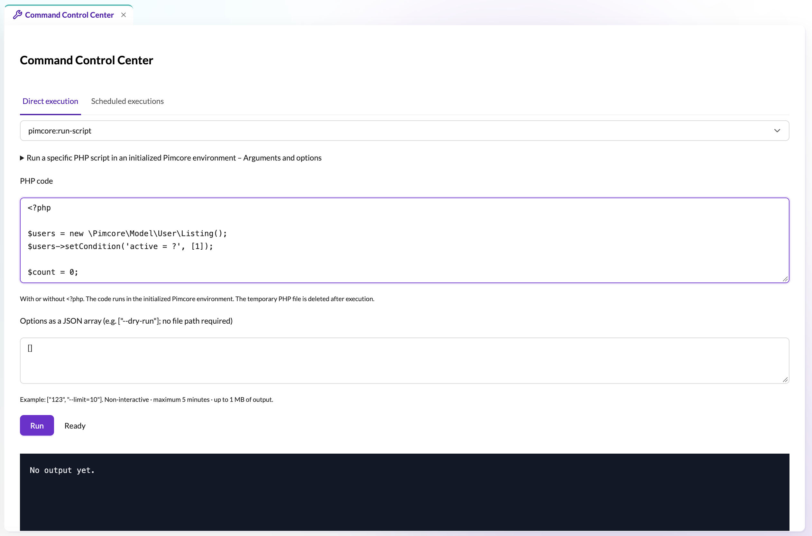

# Pimcore Command Control Center

Run Symfony console commands and PHP scripts from Pimcore Studio, or schedule them to run without an open browser.



- Search all registered console commands and inspect their arguments/options.
- Stream stdout/stderr and display the exit code.
- Paste PHP directly for `pimcore:run-script`.
- Schedule one-time, hourly, daily or weekly executions.
- Edit, enable/disable/delete plans and inspect the latest output and status.
- Persistent run history with input/output snapshots, filters and pagination.
- Reusable command templates with input fields and opt-in read-only object previews.
- Multi-step workflows that run commands in the background and stop at the first failure.
- Schedule a workflow as a fixed snapshot, with per-step progress in the run history.
- Optional interactive Linux terminal with administrator-only shell sessions in Studio.
- Administrator access and CSRF protection on mutations.

**Contents:** [Security disclaimer](#security-disclaimer) · [Requirements](#requirements) · [Install](#install) ·
[Direct execution](#direct-execution) · [Command templates and run history](#command-templates-and-run-history) ·
[Scheduled executions](#scheduled-executions) · [Workflows](#workflows) · [Failure notifications](#failure-notifications) ·
[Background worker](#background-worker) · [Interactive terminal](#interactive-terminal) · [Languages](#languages) ·
[Development](#development) ·
[Further reading](#further-reading) · [Inspiration disclaimer](#inspiration-disclaimer)

## Security disclaimer

**Use this bundle at your own risk, especially in production environments.** It allows administrators to
execute console commands, arbitrary PHP code and, when enabled, an interactive shell in your application's
environment. Incorrectly configured
administrator accounts or permissions, compromised accounts, and unsafe commands or scripts can pose
significant risks to the entire system, including data loss, disclosure of sensitive information and service
disruption. Grant administrator access only to trusted, qualified users, review commands and scripts before
execution, and maintain tested backups before using the bundle in production.

## Requirements

| Platform | Pimcore core | Studio UI / Backend | PHP |
| --- | --- | --- | --- |
| 2025.4 LTS | `^12.3` | `^2025.4` | 8.3 / 8.4, as supported by your Pimcore release |
| 2026.x | `^2026.1` | `^2026.1` | 8.4 / 8.5, as supported by your Pimcore release |

The PHP code supports Symfony 6.4 and 7.x, including Symfony 8.x CSRF tokens in newer host projects.
Pimcore Platform 2025.4 uses core **12.3**, rather than a core version named 2025.4. CI tests the PHP
dependencies and the frontend SDKs (Studio 2025.4.0 and 2026.3.2) separately; a full application smoke test
runs in the development project on Pimcore/Studio 2026.3.2 (CI does not provision a Pimcore database).

The compiled frontend ships with every tagged release (and therefore with Composer distributions), so
installing the bundle does not require Node.js. It is built by CI on the release tag; the default branch
keeps only sources. The optional interactive terminal is the one part that needs Node.js at runtime
(22+, on Linux, running as a non-root user).

## Install

Until the package is submitted to Packagist, add this GitHub repository to the host project:

```sh
composer config repositories.command-center vcs https://github.com/Waaatza/pimcore-command-center-bundle
composer require watza/command-center-bundle:^0.5
```

Register the bundle in `config/bundles.php` if your installation did not register it automatically:

```php
Watza\CommandCenterBundle\PimcoreCommandCenterBundle::class => ['all' => true],
```

Then install assets and clear the application cache:

```sh
php bin/console assets:install --symlink public
php bin/console cache:clear
```

Open **System → Command Center** in Studio as a Pimcore administrator. Routes are loaded through Pimcore's
bundle routing; the frontend uses the configured Studio API prefix. No database migration is needed.

The interactive terminal is **disabled by default** and needs its own service; see
[Interactive terminal](#interactive-terminal) to enable it.

## Direct execution

Choose a command. Arguments/options are a JSON array, with one string per CLI token:

```json
["some-argument", "--limit=10"]
```

Use `[]` for no arguments. Commands are executed without a shell and without interactive prompts, with a
five-minute process timeout. Environment, ANSI output and interaction flags are controlled by the server.

For `pimcore:run-script`, paste code in the PHP field, with or without the opening `<?php` tag:

```php
<?php
$listing = new \Pimcore\Model\DataObject\Listing();
$listing->setUnpublished(true);
$listing->setObjectTypes([
    \Pimcore\Model\DataObject::OBJECT_TYPE_OBJECT,
    \Pimcore\Model\DataObject::OBJECT_TYPE_VARIANT,
]);
echo 'Objects: ' . $listing->getTotalCount() . PHP_EOL;
```

The script runs in an initialized Pimcore environment and its temporary file is deleted on success or failure.
Inline scripts accept `--dry-run`, verbose and quiet options; do not supply a script filename.

## Command templates and run history

**Templates** turn a configured command into a small form: text, integer and choice fields substitute into the
JSON argument tokens, so recurring tasks can run without editing JSON. A template whose command has a
registered preview provider also shows the affected objects before execution. Templates do not support inline
PHP source; use direct execution or schedules for PHP scripts.

**Run history** records every new execution (direct, inline, scheduled, template and workflow runs) with
status, trigger and a snapshot of input and combined output, plus filters and pagination. Only the last 1 MB
of output is kept per run; an unfinished record becomes *Interrupted* when read after ten minutes, and history
has no automatic expiry.

See [Run history and command templates](docs/history-and-templates.md) for field syntax, storage, the
`CommandPreviewProviderInterface` example and retention details.

## Scheduled executions

1. Select/configure the command in the **Direct execution** tab.
2. Switch to the **Scheduled executions** tab.
3. Enter a name, first execution and recurrence; save the plan.

Each plan stores a separate copy of the arguments and PHP code, so changing the direct-execution form does not
change saved plans. Use **Edit** to update a plan; running plans cannot be edited, and a save that races the
worker or another administrator is rejected so you reload the latest version first. Completed one-time plans
can be scheduled again with **Edit** by choosing a future execution.

Dates are entered and displayed in the browser timezone. Daily and weekly recurrence keeps the original local
time across daylight-saving transitions, in any year; if that time does not exist on the transition day it
moves forward by the DST gap for that occurrence only. Hourly recurrence advances by exactly 3,600 seconds,
including clock changes. Existing plans capture their current local time on their next execution.

Plans and their latest results live outside the public directory in `var/command-center/<environment>/` (up to
50 plans, 1 MB of output each). Keep that directory on shared, persistent storage for web and worker and
include it in backups. A filesystem lock prevents concurrent workers from claiming the same job; after an
unexpected worker stop the unfinished job is marked interrupted and its schedule disabled, and it is never
retried automatically because it may already have modified data.

## Workflows

The **Workflows** tab chains 1–20 commands into one background run. Steps run in order and the first failure
stops the run: its exit code and error become the result, later steps are marked as skipped, and every step is
also recorded as its own history entry. **Run now** only queues a snapshot of the definition, and
**Schedule workflow** creates an ordinary schedule that stores a fixed copy of all steps (read-only
afterwards). See [Workflows](docs/workflows.md) for queued execution, scheduling, history and interruption
recovery.

## Failure notifications

Choose active Pimcore users and **E-Mail**, **Studio-Benachrichtigung**, or both when creating a schedule.
For an existing schedule, open **Details** and save its notification settings; changes apply to subsequent
runs, and leaving recipients and channels empty disables alerts. Failed runs (nonzero exit codes, exceptions
and timeouts) and worker-interrupted runs trigger alerts, successful runs do not. Each alert lists the plan,
command, status and timestamps, but not the PHP source, arguments or output; inspect the full output in the
Command Center.

Email uses Pimcore's existing mail configuration, including its sender address and transport, and recipients
need a valid email address. Studio recipients need the `notifications` permission. Users are checked again at
send time, so deleted/inactive users and revoked permissions are handled as delivery failures. Delivery
results appear with the latest run's details; a failed delivery does not rerun the command or block other
recipients/channels. Deliveries are attempted once with no automatic retry, so a worker crash during delivery
may leave an alert unsent — command execution is never replayed to send an alert.

## Background worker

Schedules and queued workflow runs execute in a worker. Keep it running in the host application's environment:

```sh
php bin/console messenger:consume scheduler_command_center --memory-limit=250M --time-limit=3600
```

Use Supervisor, systemd or your container orchestrator to restart it automatically. For Docker Compose, reuse
your application's PHP image, environment and project volume, for example:

```yaml
services:
  command-center-worker:
    image: your-project-php-image
    working_dir: /var/www/html
    command: ["php", "bin/console", "messenger:consume", "scheduler_command_center", "--memory-limit=250M", "--time-limit=3600"]
    restart: unless-stopped
    stop_grace_period: 360s
    volumes:
      - .:/var/www/html
```

The worker must reach your application's database and other services and use the same filesystem
user/permissions as the web application for `var/command-center`. The Symfony scheduler checks every ten
seconds and runs jobs serially: overdue recurrences are coalesced into one execution, a long job delays later
ones, and the tab shows the latest worker heartbeat (its absence means no worker has checked the plans yet).
Workflows and schedules share one runner lock, so a long workflow delays later plans and a long plan delays
queued workflows.

## Interactive terminal

The **Terminal** tab opens a real, interactive shell in the environment that runs the terminal service. It is
**disabled by default** and needs a dedicated Node.js service on the **same origin** as Studio. See
[Interactive terminal](docs/terminal.md) for configuration, deployment, security and limits.

## Languages

The interface follows the Studio user language and includes English and German translations for tabs, forms,
actions, status labels and application messages. Dates follow the selected UI language. Command
descriptions/output and user-supplied PHP code are not translated.

## Development

```sh
composer install
composer test
cd assets
npm ci
npm run check-translations
npm run check-types
npm run check-template-preview
npm run check-terminal
npm run build
```

The default branch contains sources only; `public/build/` is generated and is not committed. To release a
version, commit the sources (including a version bump in `assets/package.json` and `assets/package-lock.json`,
and the README's version constraint), then tag and push the tag:

```sh
git tag -a vX.Y.Z -m "vX.Y.Z - short summary"    # or -F release-notes.md
git push origin main vX.Y.Z
```

The annotated tag message is the release: its first line becomes the release title and the remaining lines
become the release notes, so list the change points there. The `Release Build` workflow then installs the
frontend dependencies, runs the build, commits the generated `public/build/` into the tag, updates the tag and
creates the GitHub release. A tag push alone therefore produces a complete, installable release.

For a local path installation in a host project, run the PHP tests against its dependencies:

```sh
COMMAND_CENTER_AUTOLOAD=/path/to/project/vendor/autoload.php php tests/CommandCenter/smoke.php
COMMAND_CENTER_AUTOLOAD=/path/to/project/vendor/autoload.php php tests/CommandCenter/schedules.php
```

The opt-in worker integration check creates a harmless, temporary scheduled PHP script and removes only its
own plan afterwards. Run it from a Git checkout or local path installation inside a configured host project
with the worker running:

```sh
COMMAND_CENTER_AUTOLOAD=/path/to/project/vendor/autoload.php php tests/CommandCenter/worker-integration.php --live-worker
```

## Further reading

- [Interactive terminal](docs/terminal.md): optional Node.js service, proxy, security and activation.
- [Tips and script examples](docs/tips.md), including
  [sending a Studio notification to all active users](docs/tips.md#notify-all-active-users).
- [Run history and command templates](docs/history-and-templates.md) for the history and template tabs,
  storage details and a preview-provider example.
- [Workflows](docs/workflows.md) for sequential background runs, queued execution, snapshots and recovery
  after a worker interruption.

## Inspiration disclaimer

This project was inspired by the [Job Manager available in the Pimcore Store](https://store.pimcore.com/shop/job-manager-213).
It is an independent implementation and is not affiliated with or endorsed by the Job Manager's authors.

MIT licensed. Pimcore and its Studio SDK retain their own licenses.
