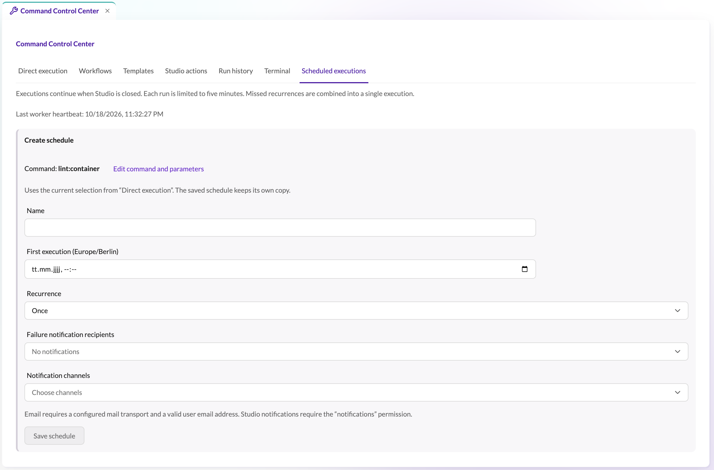

# Scheduled executions and the background worker

Schedules run console commands and PHP scripts without an open browser. Create one by configuring the command
in the **Direct execution** tab, switching to the **Scheduled executions** tab, and saving a name, first
execution and recurrence (one-time, hourly, daily or weekly).



## Plans

Each plan stores a separate copy of the arguments and PHP code, so changing the direct-execution form does not
change saved plans. Use **Edit** to update a plan; running plans cannot be edited, and a save that races the
worker or another administrator is rejected so you reload the latest version first. Completed one-time plans
can be scheduled again with **Edit** by choosing a future execution. Disabling a running recurring plan
prevents future runs and lets the current run finish.

## Recurrence and timezones

Dates are entered and displayed in the browser timezone. Daily and weekly recurrence keeps the original local
time across daylight-saving transitions, in any year; if that time does not exist on the transition day it
moves forward by the DST gap for that occurrence only, and later runs return to the original local time.
Hourly recurrence advances by exactly 3,600 seconds, including clock changes. Existing plans capture their
current local time on their next execution; if an older plan has already drifted, edit its next execution to
the intended local time once.

## Storage, retention and locking

Plans and their latest results live outside the public directory in `var/command-center/<environment>/` (up to
50 plans, 1 MB of output each). Keep that directory on shared, persistent storage for web and worker and
include it in backups. A filesystem lock prevents concurrent workers from claiming the same job; after an
unexpected worker stop the unfinished job is marked interrupted and its schedule disabled, and it is never
retried automatically because it may already have modified data.

## Background worker

Schedules and queued workflow runs execute in a worker. Keep it running in the host application's environment:

```sh
php bin/console messenger:consume scheduler_command_center --memory-limit=250M --time-limit=3600
```

Use Supervisor, systemd or your container orchestrator to restart it automatically. For Docker Compose, reuse
your application's PHP image, environment and project volume, for example:

```yaml
services:
  command-center-worker:
    image: your-project-php-image
    working_dir: /var/www/html
    command: ["php", "bin/console", "messenger:consume", "scheduler_command_center", "--memory-limit=250M", "--time-limit=3600"]
    restart: unless-stopped
    stop_grace_period: 360s
    volumes:
      - .:/var/www/html
```

The worker must reach your application's database and other services and use the same filesystem
user/permissions as the web application for `var/command-center`. The Symfony scheduler checks every ten
seconds and runs jobs serially: overdue recurrences are coalesced into one execution, a long job delays later
ones, and the Command Center tab shows the latest worker heartbeat (its absence means no worker has checked
the plans yet). Workflows and schedules share one runner lock, so a long workflow delays later plans and a long
plan delays queued workflows.
